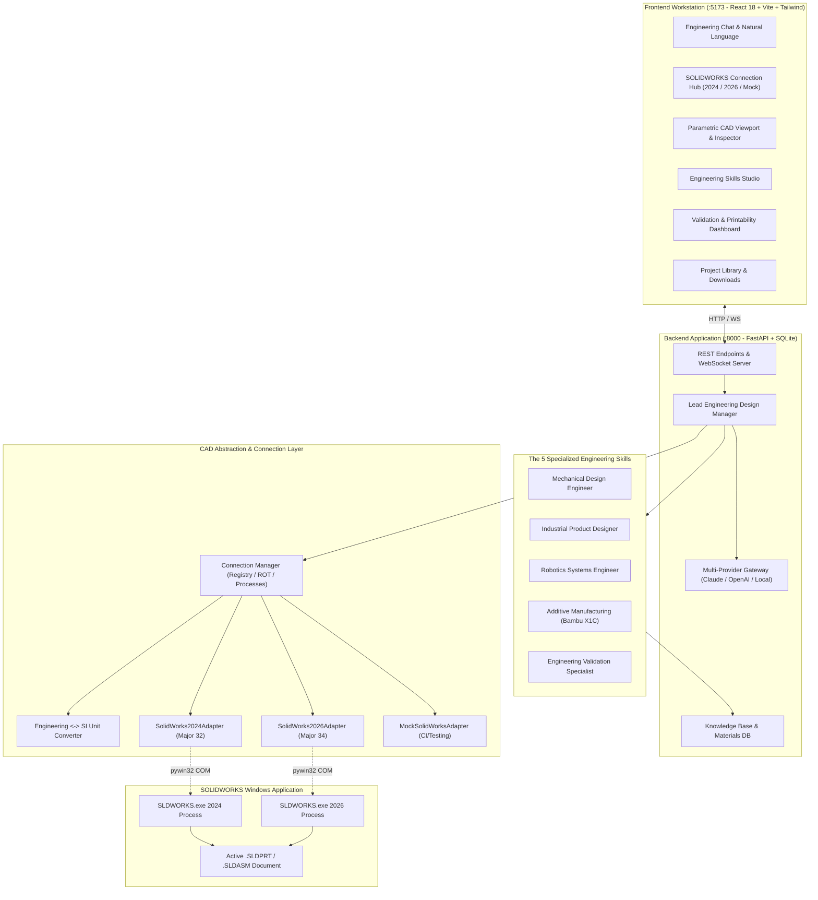

# AI Robotics Design Studio

> **An Autonomous AI-Powered Robotics & Mechanical Product Development Platform**  
> Supporting **SOLIDWORKS 2024 (Major 32)** and **SOLIDWORKS 2026 (Major 34)** Dual Automation  
> Built with **FastAPI**, **React 18**, **TypeScript**, **Tailwind CSS**, and **pywin32 COM Automation**  

[](https://www.solidworks.com/)
[](https://www.python.org/)
[](https://react.dev/)
[](https://tailwindcss.com/)
[](LICENSE)

---

## 📑 Table of Contents
1. [Overview & Value Proposition](#-overview--value-proposition)
2. [System Architecture](#-system-architecture)
3. [SOLIDWORKS Version Management & COM Engine](#-solidworks-version-management--com-engine)
4. [The 5 Specialized Engineering Skills](#-the-5-specialized-engineering-skills)
5. [User Interface & Workstation Features](#-user-interface--workstation-features)
6. [How to Start (Quick Launch)](#-how-to-start-quick-launch)
7. [Testing & Verification Suites](#-testing--verification-suites)
8. [Phase 6: Mascot Robot Product Demonstration](#-phase-6-mascot-robot-product-demonstration)
9. [REST API & WebSocket Reference](#-rest-api--websocket-reference)
10. [Open-Source Foundation & Attribution](#-open-source-foundation--attribution)
11. [Troubleshooting & FAQ](#-troubleshooting--faq)

---

## 🌟 Overview & Value Proposition

**AI Robotics Design Studio** is a local engineering platform that connects natural-language artificial intelligence directly to desktop CAD software. Engineers, roboticists, and industrial designers can describe physical products — from mounting brackets to mobile robot chassis — and have the system calculate mechanical stresses, verify 3D printability, generate parametric CAD geometry, rebuild the model, and export production files (`.SLDPRT`, `.SLDASM`, `.STEP`, `.STL`).

### Key Highlights
- **Dual-Version Targeting**: Dedicated adapters for both **SOLIDWORKS 2024** (Major 32) and **SOLIDWORKS 2026** (Major 34) with active process isolation.
- **Headless Mock Engine**: In-memory CAD simulation for rapid testing, CI/CD pipelines, or environments without active SOLIDWORKS licenses.
- **Strict Unit Safety**: Converts user engineering units ($mm, ^\circ, g$) into SOLIDWORKS internal SI units ($m, rad, kg$) to prevent scaling bugs.
- **Closed Feedback Loop**: Reads back feature trees, dimensions, mass properties, and viewport screenshots so the agent verifies its own work.

---

## 🏗️ System Architecture



---

## 🔌 SOLIDWORKS Version Management & COM Engine

### Version Detection & Isolation
When both SOLIDWORKS 2024 and 2026 are installed on the same Windows host, generic COM identifiers can cause accidental attachment to the wrong process. The **Connection Manager** ([cad/connection_manager.py](file:///d:/cad/cad/connection_manager.py)) solves this via multi-point inspection:
1. **Windows Registry Query**:
   - `HKLM\SOFTWARE\SolidWorks\SOLIDWORKS 2024\Setup` -> `SolidWorks Folder`
   - `HKLM\SOFTWARE\SolidWorks\SOLIDWORKS 2026\Setup` -> `SolidWorks Folder`
2. **Running Process Inspection**: Scans `SLDWORKS.exe` instances, matching executable paths to specific version directories.
3. **Revision Verification**:
   - Calls `swApp.RevisionNumber()`:
     - Major version `32` $\rightarrow$ **SOLIDWORKS 2024**
     - Major version `34` $\rightarrow$ **SOLIDWORKS 2026**
4. **Modal Dialog Prevention**:
   - Automatically toggles `swStopDebuggingOnError` (User Preference 11) to prevent SOLIDWORKS error popups from freezing the COM worker thread.

### The Unit Conversion Law
SOLIDWORKS COM API **strictly mandates SI units**:
| Dimension | User / UI Unit | SOLIDWORKS COM Internal Unit | Conversion Factor |
| :--- | :--- | :--- | :--- |
| **Length** | Millimeters ($mm$) | Meters ($m$) | $\times 10^{-3}$ |
| **Angle** | Degrees ($^\circ$) | Radians ($rad$) | $\times \frac{\pi}{180}$ |
| **Mass** | Grams ($g$) | Kilograms ($kg$) | $\times 10^{-3}$ |
| **Volume** | Cubic millimeters ($mm^3$) | Cubic meters ($m^3$) | $\times 10^{-9}$ |
| **Stress** | Megapascals ($MPa$ or $N/mm^2$) | Pascals ($Pa$ or $N/m^2$) | $\times 10^6$ |

All public functions accept engineering units and automatically route through [cad/units.py](file:///d:/cad/cad/units.py).

---

## 🧠 The 5 Specialized Engineering Skills

```
skills/
├── mechanical_design/        # Shigley stress, FoS, deflection, motor mounts
├── industrial_design/        # CMF (RAL 9016, RAL 1036), G2 curvature, seams
├── robotics_systems/         # 3-wheel platform, motor sizing, packaging
├── additive_manufacturing/   # Bambu Lab X1C (256mm³), heat-set inserts, splitting
└── engineering_validation/   # Rebuild errors, edge margins, printability scorecard
```

### 1. Mechanical Design Engineer
- **Formulas**:
  - Bending stress: $\sigma = \frac{M \cdot y}{I}$
  - Torsional stress: $\tau = \frac{T \cdot r}{J}$
  - von Mises equivalent stress: $\sigma_v = \sqrt{\sigma^2 + 3\tau^2}$
  - Factor of Safety: $FoS = \frac{S_y}{\sigma_v} \ge 2.0$
  - Cantilever deflection: $\delta = \frac{F \cdot L^3}{3 \cdot E \cdot I}$
- **Standards**: Fastener hole edge margin $\ge 1.5 \times d_{hole}$; NEMA 14, 17, and 23 faceplates.

### 2. Industrial Product Designer
- **Aesthetic Direction**: Aviation-inspired streamlined styling.
- **CMF Specifications**:
  - Body: **RAL 9016 Traffic White** (`#F6F6F6` high-gloss polyurethane)
  - Trim & Bezels: **RAL 1036 Satin Gold** (`#8F7242` satin anodized)
  - Visor / Face: **Obsidian Black** (`#111111` anti-reflective polycarbonate)
- **Continuity & Seams**: G2 continuous curvature fillets; uniform 1.5 mm reveal gaps.

### 3. Robotics Systems Engineer
- **Kinematic Base**: 3-wheel differential platform (2 rear driven wheels, 1 front caster).
- **Motor Sizing**:
  $$F_{total} = M \cdot g \cdot (\mu_{rr} + \sin\theta) + M \cdot a$$
  $$T_{per\_wheel} = \frac{F_{total} \cdot r_{wheel}}{2}$$
- **Stability Triangle**: Evaluates critical tip-over acceleration:
  $$a_{crit} = g \cdot \frac{b}{h_{cg}} \ge 0.45\text{g}$$
- **Packaging Envelopes**: Battery (24V 20Ah LiFePO4: $220 \times 140 \times 110\text{ mm}$ on lowest deck), Compute ($160 \times 150 \times 65\text{ mm}$), Dual Motor Controllers ($120 \times 90 \times 40\text{ mm}$).

### 4. Additive Manufacturing Engineer
- **Target Equipment**: Bambu Lab X1C and X1E ($256 \times 256 \times 256\text{ mm}$ build envelope).
- **Automated Slicing & Splitting**: Any component $>250\text{ mm}$ is automatically flagged for quadrant segmentation with alignment dowels and stepped lap joints.
- **Heat-Set Inserts**: Standard M3 brass insert specification ($\varnothing 4.0\text{ mm} \times 5.7\text{ mm}$ depth, boss wall $\ge 1.6\text{ mm}$).
- **Material Profiles**: PLA, PETG-CF, ABS-GF, PAHT-CF, PPS-CF, TPU 95A.

### 5. Engineering Validation Specialist
- **Scorecard Audits**:
  - Feature Rebuild Errors == 0
  - Manifold solid bounding box ($L, W, H > 0$)
  - Fastener edge margin verification ($\ge 1.5 \times d$)
  - Positive volume & mass properties calculation
  - Bambu Lab build envelope fit ($\le 256\text{ mm}$)
  - Static Factor of Safety check ($FoS \ge 2.0$)

---

## 💻 User Interface & Workstation Features

The frontend is a dark-slate engineering workstation built with React 18, TypeScript, and Tailwind CSS:

1. **Engineering Chat**: Natural-language instructions, live execution pipeline cards, skill badges, and mass property updates.
2. **SOLIDWORKS Connection Hub**: Modal for inspecting installed versions, process PIDs, and switching between Auto Detect, 2024, 2026, and Mock modes.
3. **CAD Workspace & Inspector**: Interactive 3D wireframe render with dimension annotations, editable driving dimensions, mass properties, and STEP/STL export buttons.
4. **Skills Studio**: Cards for the 5 engineering skills with formula preview and interactive "Run Test" buttons.
5. **Validation Dashboard**: Automated quality scorecard matrix distinguishing Passed, Warnings, and Failures.
6. **Project Library**: File manager listing all generated `.SLDPRT`, `.STEP`, and `.STL` files with one-click download buttons.

---

## 🚀 How to Start (Quick Launch)

You can launch the complete platform using either **one-click automated scripts** (which automatically check for and install missing dependencies) or **manual terminal commands**.

### Option A: One-Command Automated Launch (Recommended)

#### Using Batch (Command Prompt or File Explorer)
Double-click `start.bat` or run in Command Prompt:
```bat
.\start.bat
```
*Note: `start.bat` checks for `frontend\node_modules` and runs `npm install` automatically on the first launch.*

#### Using PowerShell
```powershell
powershell -ExecutionPolicy Bypass -File scripts/start.ps1
```

---

### Option B: Manual Launch (For Developers)

If you prefer running services in separate terminal windows for dedicated logging:

#### Terminal 1 — FastAPI Backend Server (:8000)
```powershell
# From project root d:\cad:
pip install -r requirements.txt
python -m uvicorn backend.app.main:app --host 0.0.0.0 --port 8000 --reload
```
*Expected Console Output:*
```text
INFO:     Uvicorn running on http://0.0.0.0:8000 (Press CTRL+C to quit)
INFO:     Started reloader process using WatchFiles
INFO:     Started server process
INFO:     Waiting for application startup.
INFO:     Application startup complete.
```

#### Terminal 2 — React 18 + Vite Frontend (:5173)
```powershell
# In a new terminal window:
cd d:\cad\frontend
npm install
npm run dev
```
*Expected Console Output:*
```text
  VITE v5.1.4  ready in 420 ms

  ➜  Local:   http://localhost:5173/
  ➜  Network: use --host to expose
```

---

### 🌐 Accessing the Workstation

Once launched, open your web browser to:
- **🎨 Web Engineering Workstation**: **[http://localhost:5173](http://localhost:5173)**
- **📑 Backend Swagger API Docs**: **[http://localhost:8000/docs](http://localhost:8000/docs)**

---

### 🎯 First Design Prompts to Try

Once the workstation opens in your browser:
1. **Create Parametric Bracket**:
   > *"Design a motor mounting bracket with four mounting holes, rounded corners, and a 10 mm plate thickness."*
2. **Parametric Resize**:
   > *"Increase length to 150 mm and change thickness to 12 mm."*
3. **Additive Manufacturing Check**:
   > *"Check if this bracket is printable on Bambu Lab X1C in PETG-CF."*
4. **Export Manufacturing Files**:
   > Click the **STEP** or **STL** buttons in the CAD Workspace, or type *"Export STEP and STL files."* in chat.
   > The exported files will be immediately available in the **Project Library** tab and in `d:\cad\projects\`.

---

## 🧪 Testing & Verification Suites

### Run Complete Automated Test Suite
```powershell
python scripts/run_tests.py
```
Validates:
- Engineering unit conversions ($mm \leftrightarrow m$, $^\circ \leftrightarrow rad$, $g \leftrightarrow kg$)
- Shigley mechanics formulas (inertia, bending stress, von Mises, motor torque)
- All 5 specialized skills evaluation outputs
- End-to-end Lead Agent natural language processing loops

### Run Phase 2 Benchmark Test (10-Step Parametric Bracket)
```powershell
# Test in simulated Mock mode:
python tests/test_parametric_bracket.py --mode mock --year 2024

# Test against live SOLIDWORKS 2024:
python tests/test_parametric_bracket.py --mode 2024 --year 2024

# Test against live SOLIDWORKS 2026:
python tests/test_parametric_bracket.py --mode 2026 --year 2026
```

**10 Benchmark Steps**:
1. Create part document `Test_Bracket_[YEAR].SLDPRT`
2. Sketch & extrude base plate: $100 \times 60 \times 10\text{ mm}$
3. Cut 4x mounting holes: $\varnothing 6\text{ mm}$ at $10\text{ mm}$ edge margins
4. Read back driving dimensions
5. Modify length dimension `D1@Sketch1` to $150.0\text{ mm}$
6. Rebuild model and verify **0 errors**
7. Verify updated dimensions ($150\text{ mm}$) and hole positions
8. Assign material (6061-T6 Aluminum) and query mass properties
9. Export non-empty `Test_Bracket_[YEAR].STEP`
10. Export non-empty `Test_Bracket_[YEAR].STL`

---

## 🤖 Phase 6: Mascot Robot Product Demonstration

The platform includes a dedicated generator for the 1,400 mm standing aviation mascot robot demonstration:

```powershell
python projects/generate_mascot_robot.py
```

### Generated Demonstration Outputs
Outputs are saved to `projects/mascot_robot/`:
- `Mascot_Robot_Chassis_Base.STEP` & `.STL`: 3-wheel differential aluminum chassis base ($480 \times 420 \times 6\text{ mm}$)
- `Mascot_Robot_Aviation_Wing.STEP` & `.STL`: Articulated tapered side wing ($320 \times 140 \times 15\text{ mm}$)
- `Mascot_Robot_Torso_Panel_Segment1.STEP` & `.STL`: Bambu Lab X1C modular shell segment ($240 \times 220 \times 3\text{ mm}$) with M3 heat-set insert mounting bosses
- `MASCOT_ROBOT_SPEC.md`: Formal engineering specification document covering CMF, powertrain, stability triangle, and additive manufacturing parameters

---

## 📡 REST API & WebSocket Reference

The backend exposes an interactive OpenAPI Swagger UI at `http://localhost:8000/docs`:

| Method | Endpoint | Description |
| :--- | :--- | :--- |
| `GET` | `/api/health` | System health, active CAD adapter, and LLM configuration |
| `GET` | `/api/cad/status` | Current connection status, active document, detected versions |
| `POST` | `/api/cad/connect` | Switch CAD mode (`auto`, `2024`, `2026`, `mock`) |
| `POST` | `/api/cad/disconnect` | Release COM resources cleanly |
| `GET` | `/api/cad/model-info` | Active document features, dimensions, and mass properties |
| `POST` | `/api/cad/modify-dimension` | Parametrically update a dimension value and trigger rebuild |
| `POST` | `/api/cad/rebuild` | Force rebuild and check for errors |
| `POST` | `/api/cad/checkpoint` | Create an auto-saved safety snapshot before modifications |
| `POST` | `/api/chat` | Send natural language instruction to Lead Engineering Agent |
| `GET` | `/api/skills` | List the 5 engineering skills and descriptions |
| `POST` | `/api/skills/evaluate` | Execute manual analytical evaluation on a specific skill |
| `GET` | `/api/materials` | Query engineering materials database (Metals, Polymers, Filaments) |
| `GET` | `/api/knowledge` | Query structured engineering knowledge base |
| `GET` | `/api/projects` | List all CAD files in `projects/` with download paths |
| `POST` | `/api/validation/run` | Execute full automated validation scorecard audit |
| `POST` | `/api/mascot-robot/generate` | Trigger Mascot Robot demonstration generation |
| `WS` | `/ws/chat` | Real-time WebSocket stream for agent reasoning steps |

---

## 📚 Open-Source Foundation & Attribution

This platform synthesizes research and architecture from five open-source projects:
1. **HarrierPigeon/Solidworks-MCP-Server**: High-level CAD tooling and closed-loop inspection feedback.
2. **andrewbartels1/SolidworksMCP-python**: Multi-year targeting (`--year 2026`) and production `MockSolidWorksAdapter`.
3. **eyfel/mcp-server-solidworks**: SolidWorks 2026 SP3 targeting and Feature Graph IR.
4. **alisamsam/solidworks-mcp**: Windows registry discovery and cascading COM fallbacks.
5. **kilwizac/solidworks-api-mcp**: Authoritative 14,000-method SOLIDWORKS API documentation corpus.

See [docs/CAD_INTEGRATION_COMPARISON.md](file:///d:/cad/docs/CAD_INTEGRATION_COMPARISON.md) for the complete comparative evaluation report.

---

## ❓ Troubleshooting & FAQ

#### 1. `'vite' is not recognized as an internal or external command`
- **Cause**: Node modules are not installed in the frontend directory.
- **Fix**: Run `cd frontend && npm install` (or use the updated `start.bat` which auto-installs missing dependencies).

#### 2. `Can I use this without a SOLIDWORKS license?`
- **Yes**: The platform defaults to the `MockSolidWorksAdapter`, which simulates features, recalculates real mass properties, and generates valid `.STEP` and `.STL` export files.

#### 3. `How do I force connection to SOLIDWORKS 2026 instead of 2024?`
- In the workstation UI, click the connection badge in the top right, select **SOLIDWORKS 2026**, and click **Apply Connection**. Alternatively, call `POST /api/cad/connect` with `{"mode": "2026"}`.

#### 4. `How are API keys configured?`
- Set standard environment variables:
  - `ANTHROPIC_API_KEY` for Claude models
  - `OPENAI_API_KEY` for GPT models
  - If no key is set, the system seamlessly operates using its built-in local deterministic engineering reasoning engine.

---

## 📄 License

This project is licensed under the MIT License — see the [LICENSE](LICENSE) file for details.
Attribution to open-source foundations is preserved in accordance with their respective MIT licenses.
